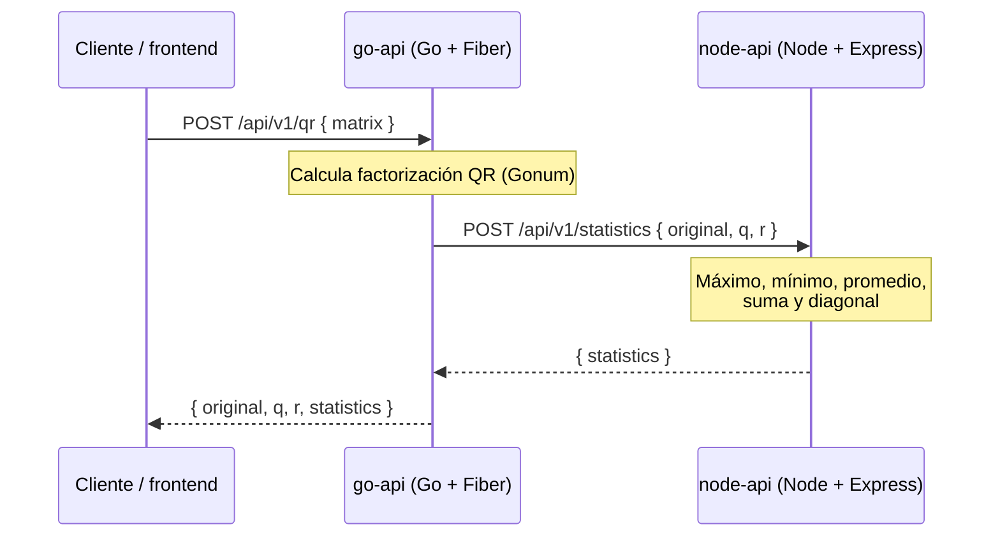

# Matrix QR — prueba técnica

Mi solución al reto: dos APIs REST que se comunican por HTTP y un frontend de prueba. El usuario envía una matriz; **go-api** calcula su factorización QR y delega las estadísticas en **node-api**; el frontend muestra todo.

## Pruébalo en vivo

| Qué | Enlace |
|---|---|
| **Frontend** (empieza aquí) | https://qr-prueba.iampol.dev |
| go-api | https://api-go.iampol.dev · [health](https://api-go.iampol.dev/health) · [docs](https://api-go.iampol.dev/docs) |
| node-api | https://api-node.iampol.dev · [health](https://api-node.iampol.dev/health) · [docs](https://api-node.iampol.dev/docs) |

**Acceso:** el login es con Logto. Puedes crear tu propia cuenta desde la pantalla de inicio de sesión, o usar esta cuenta de prueba:

- Usuario: `ejemplo@ejemplo.com`
- Contraseña: `-ti0Xpu6o`

Una vez dentro, en el panel **Developer** puedes copiar el ID token para probar las APIs a mano (Postman o el **Authorize** de `/docs`).



- **go-api** — Go 1.27 + Fiber v3. Factorización QR (Gonum) y orquestación.
- **node-api** — Node 22 + Express + TypeScript. Máximo, mínimo, promedio, suma y chequeo de matriz diagonal.
- **frontend** — React + Vite + TypeScript. Login con Logto, entrada de la matriz y resultados.

## Qué pedía el reto y qué entregué

| Requisito del enunciado | Estado |
|---|---|
| API en **Go + Fiber** que reciba una matriz y devuelva su factorización QR | ✅ |
| API en **Node.js + Express** que reciba el resultado y calcule estadísticas | ✅ |
| Comunicación entre las dos APIs por **HTTP** | ✅ go-api → node-api |
| Estadísticas: máximo, mínimo, promedio, suma total y matriz diagonal | ✅ |
| **Docker** para contenerizar y desplegar | ✅ una imagen por servicio + `docker-compose` |
| Despliegue en la **nube** | ✅ APIs en Railway, frontend en Cloudflare |
| Documentar el código con buenas prácticas | ✅ arquitectura hexagonal, OpenAPI/Swagger por API |
| *(Opcional)* Frontend que consuma ambas APIs | ✅ |
| *(Opcional)* Seguridad con **JWT** | ✅ ID token de Logto, validado en cada API |
| *(Opcional)* Pruebas unitarias y de integración | ✅ en las tres piezas |

El enunciado dice *"rotación de la matriz"* en la arquitectura pero *"factorización QR"* en la funcionalidad requerida. Implementé **factorización QR**, que es la funcionalidad concreta pedida; explico el razonamiento en el paso [`02`](logbook/02-requirements-analysis.md) y [`03`](logbook/03-mvp-answers.md) de la bitácora.

## Decisiones técnicas

El enunciado valora *"comunicar y defender las decisiones técnicas"*. Estas son las principales que tomé; el **cómo fui decidiendo**, paso a paso y con el contexto de cada momento, está en la [bitácora](logbook/README.md).

| Decisión | Por qué | Alternativa descartada |
|---|---|---|
| **HTTP** entre las APIs | Lo pide el enunciado y no ata a un proveedor ni a un formato propietario | Cola de mensajes / gRPC: más piezas para un flujo petición-respuesta simple |
| **Arquitectura hexagonal** en ambas APIs | El negocio (QR, estadísticas) se prueba sin levantar servidor ni librerías; cambiar Gonum o Express toca un solo adaptador | Capas MVC acopladas al framework |
| **QR con Gonum** (y bloque izquierdo para matrices anchas) | Librería numérica estándar y probada; se evita reimplementar álgebra lineal | Implementación propia de Householder: más riesgo de error numérico |
| **Node en TypeScript** | Tipos en los contratos de datos y menos errores en tiempo de ejecución | JavaScript plano |
| **Logto** como proveedor de identidad | Integración sencilla (SDK React + JWKS) y tenant gratuito | Auth0 (integración pesada para una prueba), Cognito (más configuración) |
| **ID token como Bearer** (sin scopes) | El plan Free de Logto no permite API resources ni scopes; cada API valida el token igualmente | Access token con scopes: requiere plan de pago |
| **Validación de JWT en cada API** | Defensa en profundidad: node-api no confía en que go-api ya validó | Validar solo en el borde (go-api) |
| **Una imagen Docker por servicio** + Compose | Imágenes mínimas y sin root; Compose levanta todo en local | Imagen monolítica |
| **Railway (APIs) + Cloudflare (frontend)** | Cloudflare Workers no ejecuta Fiber/fasthttp, así que las APIs van a un runtime que sí | Todo en un solo proveedor |

## Cómo ejecutarlo

**Local** (cada servicio en su terminal; copia cada `.env.example` primero):

```bash
make run-node        # node-api  :8081
make run-go          # go-api    :8080  (necesita node-api arriba)
make run-frontend    # frontend  :5173
```

**Docker** (las tres imágenes a la vez):

```bash
make docker-up       # construye y levanta
make docker-logs     # sigue los logs
make docker-down     # detiene y limpia
```

**Pruebas:**

```bash
make test            # pruebas de las tres piezas
```

> Los targets de `make` están pensados para **Git Bash** (en Windows, no PowerShell/CMD). El lint de cada servicio se corre en su carpeta: `go vet ./...` (go-api), `npm run lint` (node-api y frontend).

## Documentación

Documenté el soporte transversal en [`docs/`](docs/):

- [Arquitectura](docs/architecture.md) — hexagonal, capas y por qué la elegí.
- [Contrato de las APIs](docs/api-contract.md) — endpoints, request/response, errores y configuración.
- [Pruebas](docs/testing.md) — qué pruebo en cada capa y cómo correrlo.
- [Seguridad y JWT](docs/security-jwt.md) — flujo del token, validación en cada API y por qué Logto.
- [Docker](docs/docker.md) — imágenes, Compose y endurecimiento.
- [Despliegue](docs/deployment.md) — Railway, Cloudflare y configuración por dominio.

Detalle por servicio: [go-api](src/go-api/README.md) · [node-api](src/node-api/README.md) · [frontend](src/frontend/README.md).

**Bitácora:** el [registro cronológico](logbook/README.md) cuenta cómo construí la solución paso a paso, con el porqué de cada decisión en su momento. Es el mejor lugar para seguir el razonamiento y sustentarlo.

## Mejoras futuras

El alcance actual cubre el reto; según evolucione el proyecto, estos serían mis siguientes pasos:

- **Rate limiting** en ambas APIs para proteger contra abuso (por IP o por usuario del token).
- **Permisos por endpoint (RBAC con scopes).** Hoy cualquier usuario autenticado está autorizado porque el plan Free de Logto no permite API resources; con Logto Pro usaría access tokens con scopes (`qr:write`, `statistics:read`) y las APIs los exigirían. El modelo de validación ya está preparado para ese cambio (ver [seguridad y JWT](docs/security-jwt.md)).
- **Procesamiento asíncrono** para matrices grandes: en vez de una respuesta síncrona, encolar el cálculo (cola + worker) y devolver un identificador que el cliente consulta. Evita timeouts y libera el request.
- **Carga masiva / por lotes:** aceptar varias matrices en una sola petición o subir un archivo, con resultados paginados.
- **Cabeceras de seguridad y CSP en Cloudflare:** hoy solo las aplica el nginx del contenedor; replicarlas en el frontend desplegado (p. ej. con un archivo `_headers`).
- **Observabilidad:** métricas y trazas (latencia, tasa de error, llamadas go-api → node-api) además de los logs JSON actuales.
- **CI:** un pipeline que corra pruebas y lint en cada push, para no depender de ejecutarlos a mano.
