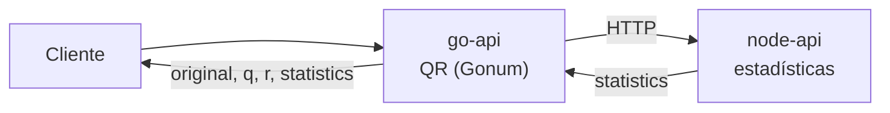
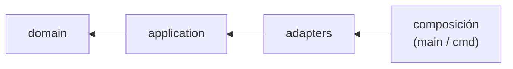

# Arquitectura

Diseñé las dos APIs con **arquitectura hexagonal (puertos y adaptadores)**: el núcleo de negocio no conoce el framework web, la librería numérica ni el cliente HTTP; conecto esas piezas desde afuera a través de interfaces (puertos).

## Visión general

1. El cliente envía una matriz a `go-api`.
2. `go-api` la valida, calcula la factorización QR y envía `original`, `q` y `r` a `node-api`.
3. `node-api` calcula las estadísticas y `go-api` devuelve todo al cliente.

Contrato detallado: `api-contract.md`.

## Capas (en ambas APIs)

Las flechas indican "importa a": el núcleo (`domain`) no depende de nadie; la composición conoce todo.
| Capa | Qué contiene | Puede depender de |
|---|---|---|
| `domain` | Reglas puras: matriz, validación, diagonal, estadísticas, errores | nada (solo librería estándar) |
| `application` | Casos de uso y puertos (interfaces) | `domain` |
| `adapters` | HTTP (Express / Fiber), Gonum, cliente HTTP, logger | `application` y `domain` |
| composición | Conecta adaptadores con puertos y arranca | todo |

Los puertos de **entrada** son lo que el exterior le pide a la aplicación (el caso de uso). Los de **salida** son lo que la aplicación necesita del exterior (factorizador, cliente de estadísticas, logger). Solo existen puertos que tienen un consumidor real.

## Cómo se hace cumplir
- **node-api:** reglas `no-restricted-imports` de ESLint por carpeta.
- **go-api:** `scripts/check_dependency_rule.sh` inspecciona el grafo real de imports con `go list -deps`.

## Documentación interactiva (Swagger)
La spec OpenAPI de cada API (`/openapi.yaml`) y su Swagger UI (`/docs`) son una preocupación del **adaptador HTTP de entrada**: viven y se sirven ahí, y ni `domain` ni `application` las conocen. Así la documentación no contamina las reglas de negocio ni la regla de dependencia.

## Por qué elegí esta arquitectura
- Pruebo las reglas de negocio sin levantar servidores ni librerías externas (doblando los puertos).
- Si cambio una tecnología (por ejemplo Gonum o Express), toco solo un adaptador.
- Ambos servicios comparten estructura y vocabulario (`matrix`, `original`, `q`, `r`, `statistics`), lo que me facilita explicarlos y mantenerlos.

## Decisiones técnicas relevantes
- **Comunicación por HTTP** entre las APIs (lo pide el enunciado y evito atarme a un proveedor).
- **QR con Gonum**, incluidas las matrices anchas mediante el bloque izquierdo cuadrado (ver `logbook/05-go-api-mvp.md`).
- **Diagonal con tolerancia** configurable (`1e-9` por defecto).
- **Sin estado, configuración por variables de entorno y logs JSON** para poder desplegar en contenedores y en la nube.

El resto de decisiones que tomé (proveedor de identidad, Docker, despliegue) y cómo fui llegando a ellas están en la [bitácora](../logbook/README.md).

## Documentación relacionada
- [Contrato de las APIs](api-contract.md) — endpoints, request/response y errores.
- [Seguridad y JWT](security-jwt.md) — cómo protejo cada ruta.
- [Pruebas](testing.md) — cómo verifico el negocio sin levantar servidores.
- [Docker](docker.md) y [Despliegue](deployment.md) — empaquetado y nube.
