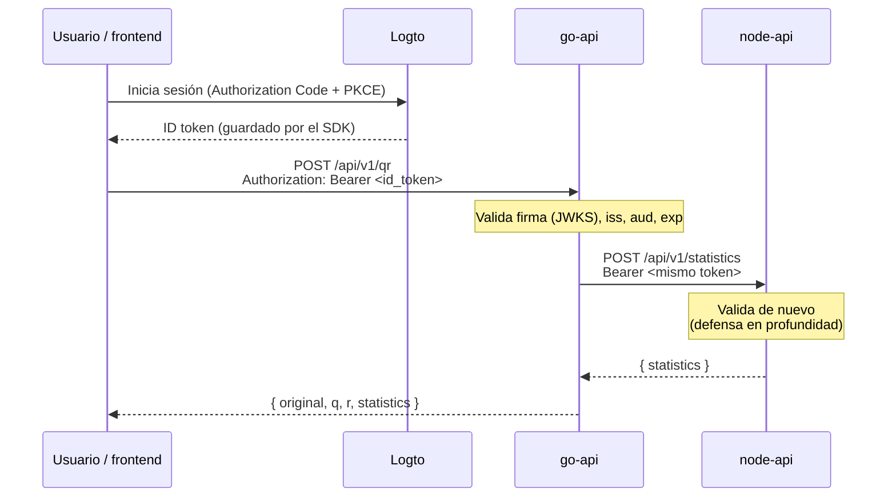

# Seguridad y JWT

Protegí las rutas de cálculo de ambas APIs con un **JWT** válido. El token es el **ID token** que Logto emite al usuario tras iniciar sesión en el frontend. Hago que cada API lo valide por su cuenta, sin ningún secreto compartido.

## Flujo de punta a punta



## Qué valida cada API

Apliqué exactamente los mismos controles en ambas APIs (go-api con `golang-jwt` + `keyfunc`; node-api con `jose`):

- **Firma asimétrica** con las claves públicas del tenant (JWKS en `‹endpoint›/oidc/jwks`, en caché). Algoritmos aceptados: **ES384** (el que usa Logto por defecto), `ES256` y `RS256`. Se rechazan `alg: none`, `HS*` y cualquier otro, lo que bloquea el ataque de confusión de algoritmo.
- **`iss`** = `‹LOGTO_ENDPOINT›/oidc` exacto.
- **`aud`** = `LOGTO_APP_ID` (el Application ID de la SPA).
- **`exp`** obligatorio y **`nbf`** si existe, con 5 s de tolerancia de reloj. `sub` obligatorio.
- **Sin scopes:** no hay comprobación de permisos; cualquier usuario autenticado está autorizado (ver *Por qué el ID token*).

Si el token falta o es inválido: **`401 UNAUTHORIZED`** con `WWW-Authenticate: Bearer` (y `error="invalid_token"` si se envió un token). El cuerpo nunca revela la causa ni el token; en los logs solo aparece un código corto (`missing_or_malformed_header`, `expired`, `invalid_signature`, `key_unavailable`, ...).

Rutas **públicas** (sin token): `GET /health`, `GET /docs`, `GET /openapi.yaml` y los preflight CORS (`OPTIONS`).

## Detalles de implementación

- **La autenticación corre antes de leer el cuerpo:** una petición sin token válido recibe 401 aunque su JSON esté roto (no se parsea).
- **JWKS en caché:** se descarga al arrancar y se refresca periódicamente (timeout de 5 s por descarga, cooldown ante `kid` desconocidos para no saturar al proveedor). Si el JWKS no está disponible, el servidor arranca igual pero rechaza los tokens cuya clave no tenga en caché: **falla cerrado**. Por paridad, esa causa responde 401 (no 503): el cliente no distingue una caída del proveedor de un token inválido.
- **Reenvío del token (go-api → node-api):** el middleware deja el token verificado en el `context`; el cliente de node-api lo lee y lo reenvía. Si node-api responde 401/403, go-api devuelve **502 `UPSTREAM_UNAVAILABLE`** sin exponer el estado ni el cuerpo del upstream.
- **El token nunca se escribe** en logs ni en mensajes de error.
- **Fail-closed de configuración:** sin `LOGTO_ENDPOINT`/`LOGTO_APP_ID` válidos, el proceso termina con código 1.

## Dónde vive (arquitectura hexagonal)

Modelé la verificación del token como un **puerto de salida** (`TokenVerifierPort`), implementado por un adaptador (`auth`), y la autenticación como un **middleware del adaptador HTTP de entrada**. El dominio y la aplicación no conocen JWT ni Logto. Por eso en las pruebas inyecto un verificador falso, y pruebo el adaptador real con claves ES384/P-384 generadas en local, sin red.

## Configuración

| Variable | Servicio | Descripción |
|---|---|---|
| `LOGTO_ENDPOINT` | go-api, node-api | Origen del tenant (p. ej. `https://‹tenant›.logto.app`). Issuer = `‹endpoint›/oidc`, JWKS = `‹endpoint›/oidc/jwks` |
| `LOGTO_APP_ID` | go-api, node-api | Application ID de la SPA: el `aud` esperado |
| `VITE_LOGTO_ENDPOINT` | frontend | Mismo endpoint, para el SDK |
| `VITE_LOGTO_APP_ID` | frontend | Mismo Application ID |

No hay ningún secreto: la SPA es un cliente público (Authorization Code + PKCE) y las APIs solo usan claves públicas (JWKS).

## Cómo obtener un token para probar a mano

Con la sesión iniciada en el frontend, abre el panel **Developer** → **Copy ID token**. Pégalo como `Bearer ‹token›` en Postman o con **Authorize** en `http://localhost:8080/docs` y `http://localhost:8081/docs`. El panel también muestra `aud`, `iss` y el tiempo restante.

```bash
curl -X POST http://localhost:8080/api/v1/qr \
  -H "Authorization: Bearer $TOKEN" \
  -H 'Content-Type: application/json' \
  -d '{"matrix":[[12,-51,4],[6,167,-68],[-4,24,-41]]}'
```

## Por qué un proveedor de identidad externo

Tomé la decisión consciente de delegar la **gestión de identidad** (registro, login, emisión y rotación de tokens) a un proveedor externo, en lugar de construirla dentro de las APIs. Las APIs no almacenan usuarios ni emiten tokens: solo **verifican** el JWT (firma con JWKS, `iss`, `aud`, `exp`).

Lo hice así para no mezclar la gestión de identidad con la lógica de negocio, en coherencia con el enfoque de servicios: cada API hace una sola cosa (go-api la factorización QR, node-api las estadísticas) y la autenticación es una preocupación transversal que resuelvo en el borde de cada servicio, no en su dominio. Encaja con la arquitectura hexagonal: la verificación del token vive en un adaptador, no en el núcleo (ver *Dónde vive*).

## Por qué Logto

Evalué Auth0, Amazon Cognito y Logto. Elegí **Logto** por su integración sencilla (SDK de React + JWKS estándar) y su tenant gratuito; Auth0 me resultó pesado de configurar para una prueba y Cognito pedía más montaje. Cuento el cambio de Auth0 a Logto en la bitácora: pasos [`13`](../logbook/13-node-api-logto.md), [`14`](../logbook/14-go-api-logto.md) y [`16`](../logbook/16-frontend-logto.md).

## Por qué el ID token (y no un access token con scopes)

El plan **Free** de Logto no permite crear API resources propios ni scopes (el RBAC pasó a ser de pago). Por eso hago que el frontend envíe el **ID token** del usuario como Bearer. Es un compromiso consciente que asumí para esta prueba:

- **Trade-off:** el ID token está pensado para el cliente, no para una API, y su `aud` es la SPA, no la API. No distingo permisos por endpoint.
- **Camino de mejora:** con Logto Pro crearía un API resource con permisos, usaría access tokens (`getAccessToken(resource)`) y volvería a exigir scopes en las APIs (403 por permiso insuficiente). Dejé el modelo de validación (firma, `iss`, `aud`, `exp`) ya preparado para ese cambio.

## Capas de seguridad adicionales

El JWT es una capa; añadí varias más (ver [`docs/docker.md`](docker.md)): CORS con lista blanca de orígenes, límite de 1 MB en el cuerpo, imágenes sin root y de solo lectura, y cabeceras de seguridad + CSP en el frontend. Además, cada servicio valida el token por su cuenta (defensa en profundidad): node-api no confía en que go-api ya lo haya hecho.
